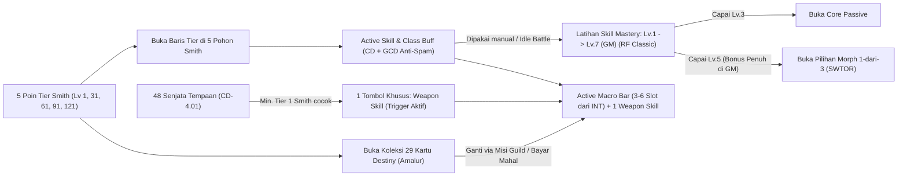

# BLUEPRINT SKILL TREE & KARTU DESTINY — BATTLE-SMITH RPG (CD v3.3)

> **Status:** `LOCKED` secara arsitektur (disepakati 21 November 2026) — **tahap desain blueprint** sebelum implementasi ke `engines/skill_engine/` dan prototipe Three.js.  
> **Pilar Gabungan:** **SWTOR Ability Tree & Cooldown Rotation** × **Kingdoms of Amalur Destiny Cards** × **RF Online Classic Skill Mastery (`Lv.1 → GM`)**.

---

## 1. Arsitektur Inti & Alur Interaksi

### Aturan Kunci yang Mengikat Sistem
1. **Peran 6 Stat Utama (`STR, DEX, CON, INT, WIS, CHA`)**:
   - Tetap menggerakkan **60 Sub-Stat (`CD-1.02b`)**, syarat senjata (`CD-4.02`), damage/HP/crit/mitigate, dan **Kapasitas Slot Active Macro Bar** dari Sub-Stat INT #6 (`Macro Capacity`): `INT 1–29 = 3 slot`, `30–74 = 4 slot`, `75–119 = 5 slot`, `120+ = 6 slot`.
2. **Aturan Anti-Spam (*Cooldown + GCD* ala SWTOR)**:
   - Setiap tombol memiliki **Cooldown individual** (`4d` s.d. `34d`) dan **Global Cooldown (`GCD = 1,2–1,5 detik`)** agar tidak bisa spam 1 tombol saja; jeda antar-skill diisi oleh *Auto-Attack* senjata (sehingga kecepatan serang DEX & *Weapon Trigger* tetap vital).
   - *Macro Bar* berisi **3–6 Slot Skill Class** + **1 Slot Khusus *Weapon Skill*** (otomatis mengikuti 48 senjata yang sedang dipakai; hanya terbuka bila pemain punya minimal Tier 1 di Smith Class terkait sesuai `CD-3.02`).
3. **Skala Latihan RF Classic *"Use-to-Level" (`Lv.1 → Lv.7 / GM`)***:
   - Setiap Active Skill, Class Buff, dan Weapon Skill naik level otomatis setiap kali digunakan (baik manual maupun lewat **Mode Idle Battle 8 Jam**!):
     - **Lv.1 → Lv.2**: `+6%` efektivitas dasar
     - **Lv.3**: `+12%` efektivitas + **Membuka *Core Passive* Tier tersebut**
     - **Lv.4**: `+18%` efektivitas
     - **Lv.5**: `+24%` efektivitas + **Membuka *Pilihan Morph 1-dari-3* (SWTOR)**
     - **Lv.6**: `+30%` efektivitas + `-5%` Cooldown
     - **Lv.7 (`GM` — Grand Master)**: `+40%` efektivitas + `-10%` Cooldown + **Bonus Puncak pada Morph aktif**!
4. **Aturan Ganti Kartu *Destiny* (`CD-3.02b` — Jalur Ganda)**:
   - Setiap Kartu *Destiny* yang syarat sebaran poin Smith-nya telah terpenuhi masuk ke koleksi pemain.
   - Mengganti Kartu *Destiny* aktif di luar pertarungan **tidak gratis** — harus memilih salah satu:
     - **Jalur Misi (*Destiny Trial* — Forgemasters' Guild)**: Selesaikan 1 misi pengukuhan (tempa 1 senjata mutu *Istimewa+* sesuai mazhab kartu tujuan, atau kalahkan 1 *Reguler Khusus/Mini Boss* di Area aktif).
     - **Jalur Bayar Instan (*Gold Sink* `WD-5.10`)**: Bayar `500br × Level × Tier` *(angka DEMO — mis. Lv10 T1 = 50s; Lv30 T1 = 1,5g; Lv90 T3 = 13,5g; Lv150 T5 = 37,5g)* di *Forgemasters' Guild* (atau *Shadow Syndicate* `+50%` bila sedang *Hostile*).
   - Mengubah distribusi **5 Poin Tier Smith** atau **Pilihan Morph** tetap mengikuti aturan *un-fuse* (`CD-2.03`).

---

## 2. Detail 5 Skill Tree Tipe Smith (25 Active/Buff + 25 Core Passive + 75 Morph)

> **Pola Baku 5 Tier Setiap Class:**  
> `T1 (Basic)` = Opener/Builder • `T2 (Expert)` = Class Buff (RF) • `T3 (Elite)` = Defensive/Interrupt (SWTOR) • `T4 (Master)` = Core Combo/Execute • `T5 (Apex)` = Ultimate Eksklusif 5 Poin Murni.  
> **Pola Baku 3 Pilihan Morph (terbuka di Skill Lv.5, bonus puncak di GM):**  
> `[1] Offense` (ubah pola serangan) • `[2] Defense / Companion` (bertahan / sinergi murid) • `[3] Forge Synergy` (diperkuat hasil tempaan bengkel).

---

### A. WEAPONSMITH (*Bladesmith → Edgewright → Warmonger → Vanquisher → Archblade*)
- **Mekanik Unik (*Resource*):** **Forge Heat** (0–5 stack). Tiap stack memberi `+3% Armor Penetration` & `+4% Weapon Trigger Power`; dapat dikonsumsi untuk *burst* berat.
- **Kecocokan Utama:** 32 Senjata Dekat (`STR/DEX/WIS/CHA`).

| Tier | Active / Buff Skill (CD) | Core Passive (`Skill Lv.3`) | Pilihan Morph 1-dari-3 (`Skill Lv.5 / GM`) |
| :---: | :--- | :--- | :--- |
| **T1** | **Tempered Cleave** *(Opener • CD 4,5d)* Tebasan busur depan, menghasilkan **+2 Forge Heat**. | **Heated Edge**: Auto-attack melee berpeluang 25% menambah +1 *Forge Heat*. | **1. Wide Arc**: Area tebasan membesar & tambah *Bleed* 4d. **2. Twin Rhythm**: Companion murid ikut memukul target (+20% dmg). **3. Sharp Alloy**: +15% damage bila senjata mutu *Bagus+*. |
| **T2** | **Anvil's Fury** *(Class Buff RF • CD 28d, Dur 16d)* +15% Attack Speed, +12% Raw Dmg, +15% Trigger Power. | **Relentless Rhythm**: Selama *Anvil's Fury* aktif, *Forge Heat* tidak luntur di luar serangan. | **1. Bloodlust Heat**: Setiap *Crit* memperpanjang durasi buff +1,5d. **2. Rallying Clang**: Setengah bonus *Attack Speed* ikut diterima Companion. **3. Masterwork Resonance**: Tiap tingkat `+N` senjata menambah +2% damage selama buff. |
| **T3** | **Pommel Sunder** *(Interrupt • CD 13d)* Hantaman gagang pembatal *Cast Bar* + Stun 2d + `-15%` Armor target. | **Iron Grip**: Berhasil melakukan *Interrupt* langsung mengisi +3 *Forge Heat* & reset 2d CD *Weapon Skill*. | **1. Shattering Blow**: Jika *Interrupt* sukses, target menerima +25% damage fisik 5d. **2. Guarding Parry**: Memberi +20% *Parry* selama 4d setelah cast. **3. Heavy Pommel**: Bonus damage +30% jika memakai senjata STR/CON berat. |
| **T4** | **Molten Sever** *(Core Combo/Execute • CD 9d)* Konsumsi seluruh *Forge Heat* untuk tebasan berat (+35% dmg bila HP musuh < 35%). | **Executioner's Temper**: Mengalahkan musuh dengan *Molten Sever* memulihkan 15 Stamina & +2 *Forge Heat*. | **1. Searing Rupture**: Meninggalkan luka bakar *Fire* setara 40% damage ledakan. **2. Crimson Drain**: 15% damage *Molten Sever* memulihkan HP pemain. **3. Trigger Overdrive**: Jika konsumsi ≥ 4 *Forge Heat*, otomatis memicu *Weapon Trigger* gratis! |
| **T5** | **Cataclysmic Anvil Fall** *(Apex Ultimate • CD 30d)* 3 hantaman beruntun skala raksasa + *AoE Armor Sunder* `-30%` + paksa *Weapon Trigger*. | **Archblade Supremacy**: Cap *Forge Heat* naik jadi 7 stack; *Weapon Trigger* mendapat +25% bonus *Crit*. | **1. Worldbreaker**: Hantaman ke-3 menjadi ledakan *Earth/Fire* AoE masif. **2. Warlord's Banner**: Seluruh tim (Pemain + Companion) kebal CC & +25% damage 6d. **3. Paragon Forge**: Damage ulti naik +12% per tahap *Resonance* senjata Unique / kualitas *Mahakarya*. |

---

### B. ARMORER (*Platesmith → Shieldwright → Bulwark → Juggernaut → Aegisborn*)
- **Mekanik Unik (*Resource*):** **Bastion Guard** (0–5 stack). Mengisi saat *Parry*, blok, atau menerima pukulan; tiap stack memberi `+3% Damage Reduction` & dapat diledakkan balik sebagai *Counter*.
- **Kecocokan Utama:** Senjata CON, Perisai, & Armor Berat/Sedang.

| Tier | Active / Buff Skill (CD) | Core Passive (`Skill Lv.3`) | Pilihan Morph 1-dari-3 (`Skill Lv.5 / GM`) |
| :---: | :--- | :--- | :--- |
| **T1** | **Shieldbreaker Bash** *(Opener • CD 5d)* Hantaman defensif berskala `CON + AC`, +2 *Bastion Guard*, menarik *Aggro*. | **Tempered Plate**: Setiap kali *Mitigate* menahan serangan, +1 *Bastion Guard* (CD internal 1,5d). | **1. Spiked Rim**: Tambah *Thorns* damage setara 25% nilai AC armor. **2. Protective Taunt**: Mengurangi damage musuh ke Companion sebesar 25% selama 5d. **3. Reinforced Buckler**: Jika memakai Perisai (Slot 25% AC), damage & stun naik +30%. |
| **T2** | **Ironclad Stance** *(Class Buff RF • CD 28d, Dur 18d)* +15% Mitigate, +15% Armor, +20% *Poise* anti-stagger. | **Unmovable Mass**: Saat *Ironclad Stance* aktif, penalti kecepatan Armor Berat (`-5%`) dihapus total. | **1. Molten Armor**: Penyerang jarak dekat terkena pantulan damage *Fire*. **2. Shared Aegis**: 40% nilai *Mitigate* pemain ikut melindungi Companion. **3. Layered Plating**: Bonus +4% HP maks untuk setiap slot Armor Berat yang dipakai (maks +20%). |
| **T3** | **Bulwark Slam** *(Interrupt • CD 12d)* Gelombang hentakan perisai AoE, membatalkan *Cast Bar* + mendorong musuh + *Barrier* 12% HP. | **Counter Fortress**: *Interrupt* sukses langsung mengisi penuh *Bastion Guard* (5 stack) & memulihkan 8% HP. | **1. Tremor Shock**: Menciptakan retakan *Earth* yang memperlambat gerak & serang musuh -25%. **2. Sanctuary Wall**: *Barrier* juga diberikan kepada Companion murid. **3. Attuned Plate**: Menambah +15% resistensi terhadap elemen musuh yang baru di-interrupt (sesuai Armor Sedang/Attunement). |
| **T4** | **Retribution Nova** *(Core Combo • CD 10d)* Ledakkan semua *Bastion Guard* menjadi gelombang kejut AoE + pulihkan 3% HP per stack. | **Stoic Recovery**: Selama *Retribution Nova* sedang cooldown, regenerasi Stamina naik +25%. | **1. Vengeance Spike**: Damage ledakan ditambah 35% dari total damage yang ditahan dalam 6d terakhir. **2. Immortal Stand**: Memberi *Barrier* setara 2× jumlah HP yang dipulihkan. **3. Tempered Shrapnel**: Bonus damage +20% bila total rata-rata `+N` pada 5 slot armor ≥ +3. |
| **T5** | **Aegis of Emberhold** *(Apex Ultimate • CD 32d)* Selama 6d kebal *Stagger*, serap 60% damage masuk ke *Barrier*, lalu ledakkan balik 150% damage terserap! | **Aegisborn Bastion**: Cap *Mitigate* (`50%`) naik menjadi `60%`; sekali per 90d mencegah kematian (sisa 15% HP). | **1. Judgment Reflect**: Ledakan akhir otomatis memicu *Stun* 2,5d pada semua musuh di sekitar. **2. Citadel Oath**: Companion tidak bisa jatuh di bawah 1 HP selama 6d durasi ulti. **3. Living Mithril**: Seluruh 5 slot armor menggandakan bonus pasif kelas bahannya (*Ringan/Sedang/Berat*) selama 10d. |

---

### C. RANGESMITH (*Bowyer → Fletcher → Deadeye → Ballistary → Horizoner*)
- **Mekanik Unik (*Resource*):** **Hunter's Mark** (0–5 stack pada target). Tiap stack mengurangi *Dodge* musuh `-4%` & menambah `+4% Crit Damage` dari serangan jarak jauh.
- **Kecocokan Utama:** 16 Senjata Jarak Jauh lintas 6 stat (`CD-4.01 & CD-4.04`).

| Tier | Active / Buff Skill (CD) | Core Passive (`Skill Lv.3`) | Pilihan Morph 1-dari-3 (`Skill Lv.5 / GM`) |
| :---: | :--- | :--- | :--- |
| **T1** | **Pinning Shot** *(Opener • CD 4d)* Tembakan presisi jarak jauh (+2 *Hunter's Mark*), memperlambat gerak musuh `-25%` 3d. | **Keen Draw**: Serangan dari jarak `≥ 4m` mendapat +8% *Accuracy* & +1 *Hunter's Mark* pada *Crit*. | **1. Barbed Tip**: Memicu *Bleed* berlipat sesuai jumlah stack *Hunter's Mark*. **2. Flank Signal**: Companion mendapat +25% kecepatan gerak menuju target bertanda. **3. Finely Machined**: Bonus +15% kecepatan proyektil & damage bila senjata punya sub-stat *Mechanism Craft*. |
| **T2** | **Eagle Sight** *(Class Buff RF • CD 26d, Dur 16d)* +12% Accuracy, +10% Dodge, +15% Jarak Tembak, +8% Crit Chance. | **Windstep**: Setiap kali berhasil *Dodge* saat *Eagle Sight* aktif, CD semua skill *Rangesmith* berkurang `-1d`. | **1. Predator Focus**: Setiap 3 serangan berturut-turut pasti *Critical*. **2. Smoke Veil**: Mengaktifkan *Eagle Sight* menghilangkan *Aggro* musuh 3d (dialihkan ke Tank/decoy). **3. Featherlight Gear**: Bonus +6% Dodge tambahan bila memakai ≥ 3 slot Armor Ringan. |
| **T3** | **Disrupting Volley** *(Interrupt • CD 13d)* Melompat mundur (*Backstep* `3,5m`) sambil menembak kipas 3 proyektil pembatal *Cast Bar*. | **Evasive Reflex**: *Backstep* memberi kebal serangan sesaat (`0,5d`) & langsung mengisi +2 *Hunter's Mark*. | **1. Shrapnel Fan**: Jumlah proyektil naik jadi 5 busur lebar untuk membersihkan gerombolan. **2. Snare Net**: Meninggalkan perangkap di posisi awal yang mengikat musuh 2d. **3. Quick-Load Quiver**: Memicu *Weapon Trigger* jarak jauh dengan kekuatan 75% saat mendarat. |
| **T4** | **Heartseeker Pierce** *(Core Combo/Execute • CD 9d)* Konsumsi seluruh *Hunter's Mark* untuk tembakan penembus `100% Armor` + `Crit Severity +35%`. | **Deadeye Ricochet**: Jika *Heartseeker Pierce* menghasilkan *Crit*, proyektil memantul ke 1 musuh terdekat (60% dmg). | **1. Armor Rend**: Target tetap kehilangan 20% Armor selama 6d setelah tembakan. **2. Marking Tether**: Mengembalikan 2 stack *Hunter's Mark* jika target adalah *Mini Boss/Boss*. **3. Attuned Bolt**: Mengubah elemen tembakan mengikuti *Attunement* senjata dengan bonus +20% *Weakness Exploit*. |
| **T5** | **Horizon Starfall** *(Apex Ultimate • CD 28d)* Hujan proyektil bertubi-tubi selama 3d ke zona target sambil bebas bergerak (*kiting* penuh!). | **Horizoner Supremacy**: Penalti damage senjata jauh (`x0,9`) dihapus total (`x1,0`), plus jarak serang +20%. | **1. Meteor Rain**: Gelombang terakhir meledak dengan damage *Fire/Lightning* AoE. **2. Phantom Decoy**: Meninggalkan bayangan pengecoh yang menarik serangan Boss selama 4d. **3. Master Ballistics**: Setiap 2 proyektil yang kena memicu efek *Weapon Trigger* senjata jauh. |

---

### D. RUNESMITH (*Runescribe → Glyphwright → Spellforger → Arcanist → Runelord*)
- **Mekanik Unik (*Resource*):** **Elemental Charge** (0–3 slot muatan dari **6 Elemen**: *Fire, Ice, Lightning, Earth, Light, Dark*). Memicu ledakan **6 Reaksi Fusi Hibrida** (*Steam, Magma, Froststorm, Eclipse, Quake-Volt, Plasma*) saat 2 elemen berbeda diledakkan bersamaan!
- **Kecocokan Utama:** Senjata INT/Rune, Senjata Hasil Fusi Hibrida, & Item ber-Slot Rune.

| Tier | Active / Buff Skill (CD) | Core Passive (`Skill Lv.3`) | Pilihan Morph 1-dari-3 (`Skill Lv.5 / GM`) |
| :---: | :--- | :--- | :--- |
| **T1** | **Runic Bolt** *(Opener • CD 4,5d)* Proyektil rune mengikuti elemen senjata (*Attunement*), menanam **+1 Elemental Charge**. | **Glyph Resonance**: Memukul musuh sesuai kolom `weak` memberi +1 *Elemental Charge* tambahan & +10% *Weakness Exploit*. | **1. Chain Glyph**: Memantul ke 2 musuh terdekat bila mengenai target yang sudah punya *Charge*. **2. Siphon Rune**: Memulihkan 6 Stamina & 3% HP tiap memicu *Weakness Exploit*. **3. Dual-Core Echo**: Bila senjata hasil **Mode Fusi**, 1 cast langsung menanam **2 Elemen Hibrida** sekaligus! |
| **T2** | **Arcane Attunement** *(Class Buff RF • CD 28d, Dur 18d)* +18% Elemental Potency, +15% *Weakness Exploit*, & memperkuat efek Rune terpasang `+25%`. | **Elemental Flux**: Selama buff aktif, serangan yang berlawanan elemen musuh tidak lagi kena penalti `-25%` (menjadi `x1,0`). | **1. Overcharged Runes**: Setiap skill aktif memercikkan petir/api tambahan 25% INT. **2. Prismatic Ward**: Memberi *Elemental Barrier* +20% resistensi 6 elemen untuk pemain & Companion. **3. Socket Mastery**: Menambah +4% Skill Damage untuk setiap **Slot Rune** yang terisi pada senjata (maks +20% di Unique 5 slot). |
| **T3** | **Nullify Seal** *(Interrupt • CD 14d)* Segel rune pembatal *Cast Bar* + *Silence* 2d + menyerap 15% HP sebagai *Arcane Barrier*. | **Spell Eater**: Membatalkan *Cast Bar* otomatis mengubah elemen *Charge* berikutnya menjadi **elemen `weak` target**! | **1. Backlash Seal**: Musuh yang di-interrupt langsung meledak menerima damage elemen kelemahannya. **2. Purifying Ward**: Menghapus 1 debuff/racun pada pemain & Companion. **3. Runic Extraction**: Menurunkan CD *Prismatic Detonation* sebesar `-3d` saat *Interrupt* berhasil. |
| **T4** | **Prismatic Detonation** *(Core Combo • CD 9,5d)* Ledakkan semua *Elemental Charge*; jika ada ≥ 2 elemen berbeda, memicu **Reaksi Fusi Hibrida** (*Magma / Froststorm / Eclipse / Steam*)! | **Catalyst Cascade**: Memicu *Reaksi Fusi Hibrida* menambah +20% *Elemental Damage* pemain selama 6d. | **1. Volatile Fusion**: Radius ledakan Fusi meluas & meninggalkan zona elemen 4d. **2. Harmonic Shield**: Tiap *Charge* yang diledakkan memberi +6% *Barrier* bertahan. **3. Conscience Infusion**: Menambah bonus damage *Light* (Mulia) atau *Dark* (Kejam) mengikuti bar *Conscience* senjata! |
| **T5** | **Sovereign Runestorm** *(Apex Ultimate • CD 32d)* Badai 6 Elemen melanda area selama 4d; otomatis mendeteksi & menembak **kelemahan (`weak`) tiap musuh**! | **Runelord Omniscience**: Semua serangan elemen mengabaikan 25% resistensi lawan & *Weakness Exploit* bisa *Critical* ekstra. | **1. Eclipse Singularity**: Menarik semua musuh ke pusat badai lalu meledakkan *Eclipse (Light+Dark)*. **2. Astral Sanctuary**: Memulihkan 4% HP/detik bagi Pemain & Companion di dalam badai. **3. Living Grimoire**: Tiap Rune pada senjata & armor menembakkan 1 peluru rune tambahan selama badai. |

---

### E. REFORGER (*Tinkerer → Temperer → Transmuter → Alchemizer → Sovereign*)
- **Mekanik Unik (*Resource*):** **Overclock** (0–5 stack). Bertambah tiap kali pemain merotasi **2 skill berbeda berturut-turut** (sangat cocok dengan sistem anti-spam!) atau saat **Companion Murid** menyerang. Dipakai untuk manipulasi *Cooldown*, *buff `+N`*, dan sinergi Companion!
- **Kecocokan Utama:** Semua senjata/armor ber-`+N`, barang hasil *Transfer +N*, & gaya tempur taktis + Companion.

| Tier | Active / Buff Skill (CD) | Core Passive (`Skill Lv.3`) | Pilihan Morph 1-dari-3 (`Skill Lv.5 / GM`) |
| :---: | :--- | :--- | :--- |
| **T1** | **Tactical Strike** *(Opener • CD 4,5d)* Serangan adaptif (mengikuti jarak senjata terpasang), +2 *Overclock*, menandai target untuk Companion. | **Clockwork Flow**: Merotasi 2 tombol skill berbeda berturut-turut otomatis menambah +1 *Overclock* & +5% damage. | **1. Exploit Seam**: Mengurangi *Defense/Mitigate* target `-15%` selama 5d. **2. Command Assist**: Serangan Companion berikutnya pada target pasti **Critical!** **3. Tempered Edge +N**: Bonus damage +4% untuk setiap tingkat `+N` pada senjata terpasang. |
| **T2** | **Temper Overdrive** *(Class Buff RF • CD 30d, Dur 18d)* Menaikkan efektifitas `+N` senjata & armor sementara (`+2` di Lv1, `+4` di GM) + `-12%` Cooldown Recovery. | **Thermal Efficiency**: Selama *Temper Overdrive* aktif, penggunaan stamina skill/idle turun `-20%`. | **1. Volatile Overheat**: Tiap skill yang dipakai saat Overdrive meledakkan percikan *Fire/Lightning*. **2. Squadron Overdrive**: Companion murid ikut mendapat +20% *Attack Speed* & +15% *Damage Reduction*. **3. Alchemy Flask**: Menambah +15% peluang *Rare Drop* & +10% efektivitas potion/pulih. |
| **T3** | **Flashbang Quench** *(Interrupt • CD 14d)* Bom uap pendingin: membatalkan *Cast Bar*, membutakan musuh (`-25% Accuracy` 4d), & +2 *Overclock*. | **Precision Dismantle**: Membatalkan *Cast Bar* mengurangi sisa *Cooldown* seluruh skill Macro Bar sebesar `-2d`. | **1. Acidic Vapor**: Uap pendingin merusak armor musuh & memberi *Earth/Acid DoT* 5d. **2. Rescue Smoke**: Menarik Companion mundur & memulihkan 15% HP-nya. **3. Salvage Spark**: Memberi peluang 25% menjatuhkan ekstra 1 material *Common/Uncommon* saat musuh mati. |
| **T4** | **Chrono Rewind** *(Core Combo • CD 10d)* Konsumsi seluruh *Overclock* untuk ledakan energi adaptif + **memangkas CD 2 skill lain di Macro Bar** (`-1d` per stack, maks `-5d`)! | **Perpetual Gear**: Menggunakan *Weapon Skill* segera setelah *Chrono Rewind* memicu +30% bonus damage. | **1. Double Tap**: Menggandakan jumlah hit *Weapon Skill* berikutnya. **2. Time Mend**: Mengembalikan 12% HP yang hilang dalam 4 detik terakhir. **3. Reforged Perfection**: Mengembalikan 100% *Weapon Trigger* jika sedang terkunci cooldown. |
| **T5** | **Masterpiece Transmutation** *(Apex Ultimate • CD 34d)* Menciptakan *Forge Domain* selama 8d: semua *Cooldown* `-35%`, *Weapon Trigger* terpicu tiap 2 pukulan, & Companion melepas jurus kolaborasi! | **Sovereign Artificer**: Semua bonus dari *Enhance +N*, *Trait Tempa*, dan *Loyalitas Companion* meningkat `+25%`. | **1. Arsenal Rain**: Memanggil 4 proyektil senjata tempaan dari Galeri Trofi yang menghujani target. **2. Grand Marshal**: Memanggil bantuan bayangan dari hingga **2 Murid lain** secara serentak selama 6d. **3. Resonance Awakening**: Selama *Forge Domain*, senjata non-Unique sementara mendapat bonus setara *Resonance Tier 1*! |

---

## 3. Koleksi 29 Kartu *Destiny* (Kingdoms of Amalur × `CD-3.02b`)

> Setiap Kartu *Destiny* memiliki **1 Bonus Pasif Skala Tier** + **1 Efek Signature Unik** yang langsung mengubah pola rotasi *Cooldown / Proc / Weapon Skill* Anda.

### A. 5 Kartu *Destiny* Murni (1 Class — Tumbuh dari Tier 1 s.d. Tier 5)
| Jalur Class (T1 → T5) | Bonus Pasif Skala (T1..T5) | Efek Signature Unik (Aktif Penuh di T3–T5) |
| :--- | :--- | :--- |
| **Weaponsmith** `Bladesmith → Archblade` | Melee Dmg +6%..+30% Armor Pen +3%..+15% | **Blade Tempest**: Saat *Critical* melee terjadi, *Weapon Trigger* terpicu **2×** & tumpukan *Forge Heat* tidak pernah turun di bawah 1. |
| **Armorer** `Platesmith → Aegisborn` | Max HP +6%..+30% Mitigate +3%..+15% | **Unbroken Mirror**: Setiap berhasil *Parry* atau menahan serangan berat Boss, memantulkan gelombang kejut AoE & mengisi +1 *Bastion Guard*. |
| **Rangesmith** `Bowyer → Horizoner` | Ranged Dmg +6%..+30% Dodge/Acc +3%..+15% | **Horizon Piercer**: Tembakan dari jarak `≥ 5m` menembus garis musuh & setiap *Dodge* mereset `1,5d` CD *Weapon Skill*. |
| **Runesmith** `Runescribe → Runelord` | Elem Dmg +6%..+30% Weakness +4%..+20% | **Twin Catalyst**: Dapat memicu **2 Reaksi Fusi Hibrida** beruntun tanpa jeda & setiap *Weakness Exploit* mengisi 1 *Elemental Charge* acak. |
| **Reforger** `Tinkerer → Sovereign` | CDR -3%..-15% Enhance & Companion +6%..+30% | **Grand Overclock**: Companion murid otomatis **meniru** *Class Buff* Anda & merotasi 3 skill berbeda mereset `2d` CD *Chrono Rewind*. |

### B. 20 Kartu *Destiny* Gabungan 2-Class Berarah (Utama + Sekunder)
*(Jika rasio seri 2+2, mengacu pada class yang diambil lebih dulu sesuai `CD-3.02b`.)*

| Utama | + Sekunder | Nama Kartu *Destiny* | Efek Signature Unik Berarah |
| :--- | :--- | :--- | :--- |
| **Weaponsmith** | + Armorer | **Vanguard** | Mengaktifkan *Opener/Combo* Weaponsmith memberi *Barrier* 8% HP; selama *Barrier* utuh, damage melee +18%. |
| **Weaponsmith** | + Rangesmith | **Skirmisher** | Memakai skill jarak jauh lalu langsung menyerang dekat (atau sebaliknya) memicu **Blitz Strike** (+25% dmg & +20% *Move Speed* 3d). |
| **Weaponsmith** | + Runesmith | **Spellblade** | Setiap pukulan senjata dekat menanam **Rune Mark**; skill elemen yang mengenai target bertanda meledak `+30%` damage! |
| **Weaponsmith** | + Reforger | **Hellforger** | Tumpukan *Forge Heat* menaikkan `+N` senjata sementara di tengah pertarungan & memicu percikan *Fire* pada tiap ayunan. |
| **Armorer** | + Weaponsmith | **Wardensmith** | Setiap tumpukan *Bastion Guard* juga menambah `+4%` damage melee & *Shieldbreaker Bash* memicu *Bleed*. |
| **Armorer** | + Rangesmith | **Sentinel** | Berhasil *Dodge* atau *Parry* otomatis melepaskan **Counter Shot** jarak jauh gratis (CD internal 3d) + perisai tipis. |
| **Armorer** | + Runesmith | **Runeguard** | Menahan serangan berelemen mengisi *Bastion Guard* sekaligus menyerap elemen tersebut ke senjata untuk serangan balik *Attunement*! |
| **Armorer** | + Reforger | **Ironclad** | Saat HP turun di bawah 50%, otomatis memicu **Emergency Overclock** (pangkas seluruh CD defensif `-4d` & *Barrier* 18% HP, CD 35d). |
| **Rangesmith** | + Weaponsmith | **Outrider** | Tembakan jarak jauh mengisi *Forge Heat*; musuh yang mendekat `< 2,5m` langsung terkena tebasan balasan **Close-Quarters Cut**! |
| **Rangesmith** | + Armorer | **Bastionbow** | Bisa memakai Perisai/Armor Berat dengan senjata jauh tanpa penalti kecepatan; diam menembak `2d` memberi **Fortified Aim** (+20% Mitigate & +15% Dmg). |
| **Rangesmith** | + Runesmith | **Arcarcher** | Tembakan pada target ber-*Hunter's Mark* otomatis berubah menjadi elemen `weak` musuh & menanam *Elemental Charge*! |
| **Rangesmith** | + Reforger | **Artificer** | Setiap 3 tembakan jarak jauh menaruh **Auto-Turret / Mekanisme Tempa** mini (durasi 6d) yang ikut menembak & memicu *Overclock*! |
| **Runesmith** | + Weaponsmith | **Hexblade** | Setelah memakai skill elemen, senjata dekat menyala **Arcane Edge** (4d): ayunan dekat berikutnya otomatis memicu *Weakness Exploit*! |
| **Runesmith** | + Armorer | **Aegisrune** | Memicu ledakan *Elemental Charge* mengubah 25% damage ledakan menjadi **Runic Barrier** yang memantulkan damage elemen. |
| **Runesmith** | + Rangesmith | **Starfletcher** | *Runic Bolt* & skill elemen mendapat jarak tembak +25% dan mewarisi bonus *Crit Severity* dari tumpukan *Hunter's Mark*. |
| **Runesmith** | + Reforger | **Thaumaturge** | Efek *Slot Rune* pada senjata digandakan saat *Overclock* ≥ 3, dan memicu *Fusi Hibrida* mengurangi biaya Stamina 50%. |
| **Reforger** | + Weaponsmith | **Reaver** | Mengonsumsi *Overclock* memicu **Frenzy Swing** (+25% Attack Speed & 8% *Lifesteal* fisik selama 5d). |
| **Reforger** | + Armorer | **Colossus** | *Temper Overdrive* menggandakan *Poise* & *Armor* pemain serta membuat Companion ikut menarik *Aggro* bergantian (*Dual-Tank*). |
| **Reforger** | + Rangesmith | **Machinist** | Mengisi *Overclock* otomatis menembakkan **Micro-Bolt** jarak jauh ke target bertanda & memangkas CD *Disrupting Volley*. |
| **Reforger** | + Runesmith | **Chronosmith** | Setiap kali memicu **Weakness Exploit**, memangkas *Cooldown* seluruh tombol di *Macro Bar* sebesar `-1,5 detik` (CD internal 4d)! |

### C. 4 Kartu *Destiny* Multi-Class (3–5 Class — Gaya *"Universalist"* Amalur!)
| Syarat Sebaran | Nama Kartu *Destiny* | Efek Signature Unik Multi-Class |
| :--- | :--- | :--- |
| **3 Class** (dominan Runesmith/Reforger) | **Polymath** | Bonus +1 Slot *Macro Bar* ekstra + setiap memicu *Elemental Charge* atau *Overclock* menaikkan *Crit & Elemental Potency* +12% (stack 3×). |
| **3 Class** (dominan Weapon/Armor/Range) | **Arsenist** | Bisa membawa **2 Senjata Aktif (Swap Cepat di Pertarungan!)** tanpa penalti; berganti senjata otomatis memangkas CD *Weapon Skill* `-3d`! |
| **4 Class** (kombinasi 4 pohon) | **Synthesist** | Setiap *Core Passive* dari 4 pohon saling berbagi tumpukan (mengisi 1 jenis *Resource* berpeluang 50% mengisi +1 *Resource* pohon lain!). |
| **Semua 5 Class** (`1+1+1+1+1`) | **Omnismith** | **Master of All Forges**: Bebas memakai seluruh **48 Senjata** tanpa penalti + merangkai 3 tombol dari **Smith Class berbeda** memicu **Omni-Surge** (+25% semua damage, `-2d` seluruh CD, & *Weapon Trigger* otomatis!). |

---

## 4. Ringkasan Dampak ke Sistem Lain (Checklist Sebelum Tahap Coding)

- **Tidak Ada Konflik dengan World Development (`master_WD_v1.9.md`)**:
  - 6 Elemen + Neutral, 6 Reaksi Fusi Hibrida, 4.864 Musuh (kolom `el/weak`), 5 Murid Companion, *Forgemasters' Guild*, *Shadow Syndicate*, dan ekonomi *High Velocity High Sink* (`WD-5.09–5.10`) semuanya langsung terserap mulus!
- **Yang Akan Dimigrasi Nanti (Saat Anda Memberi Lampu Hijau Coding)**:
  1. `engines/skill_engine/skill_data.json` & `skill_engine.js` → pindah dari 6 pohon stat lama ke 5 Smith Skill Tree + 29 Kartu Destiny + tracker `Lv.1 → GM`.
  2. `prototypes/tidewrack_threejs/` → tambahkan 1 tombol khusus *Weapon Skill*, tracker `Lv.1 → GM`, layar pilih *Smith Class* & *Kartu Destiny*!
